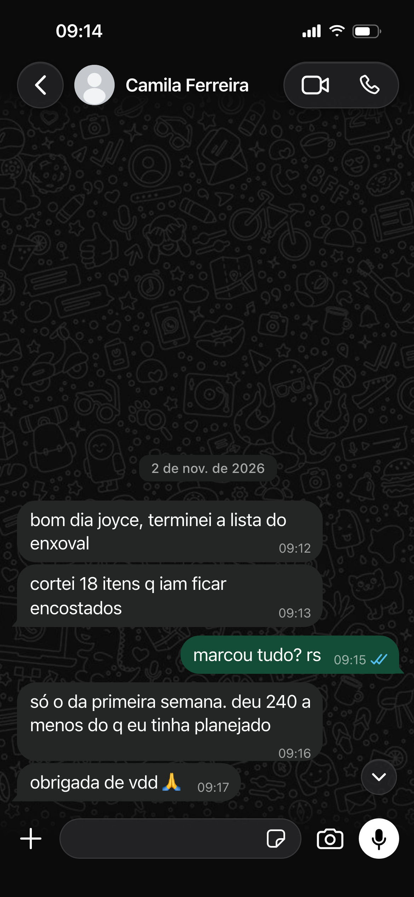

# WhatsApp Print

Gera PNG idêntico ao WhatsApp iOS (claro / escuro). Tem editor **100% no browser**.

## Editor online

https://whatsapp-print.pages.dev/

Cloudflare Pages free (estático). Sem Worker, sem domínio pago.

Espelho no R2 (URL feia, mesmo arquivo):  
https://pub-1201b8b15bf3455ab30396aa22245d5f.r2.dev/index.html

Dois exemplos no site: **escuro** e **claro**. Clique no texto/foto pra editar, escolha o tema, gere o PNG.

## Aba "Página / matéria"

Segunda aba do editor: modelo de página de portal de notícias (cabeçalho, editoria, título, linha fina, foto com legenda e corpo opcional), com os mesmos textos do modelo. Tudo editável no painel esquerdo ou direto na prévia; a foto troca por upload/URL. Exporta PNG 1724px (862 CSS @2x).

Abra direto em https://whatsapp-print.pages.dev/#materia

Arquivos: `web/materia.mjs` (markup + CSS do modelo), `web/fonts/` (Playfair Display + Inter self-hosted, necessário pro export inlinar as fontes).

| Escuro | Claro |
|---|---|
|  |  |

## Setup local

```fish
cd ~/dev/whatsapp-print
bun install
bunx playwright install chromium
```

## CLI

```fish
bun run generate conversa.json
bun run gestante          # lote gestante claro+escuro
bun run from-json         # regenera a partir de conversas/gestante/*.json
bun run exemplos          # assets do README
```

Editor local (Node, lista as conversas do disco):

```fish
bun run editor   # http://127.0.0.1:3847
```

Cópia estática (mesma do R2), servir local:

```fish
cd web
python3 -m http.server 5173
# http://127.0.0.1:5173
```

## JSON

| Campo | Descrição |
|---|---|
| `contato` | Nome no header |
| `foto` | Caminho / URL / data URL |
| `tema` | `claro` ou `escuro` |
| `horaStatus` | Status bar |
| `bateria` | 0–100 |
| `mensagens` | lista abaixo |

```json
{ "tipo": "data", "texto": "2 de nov. de 2026" }
{ "de": "eu", "texto": "Oi", "hora": "09:10", "status": "lido" }
{ "de": "ela", "texto": "E aí", "hora": "09:11", "imagem": "./foto.png" }
```

## Deploy do editor

```fish
# Pages (URL boa, free)
set -x CLOUDFLARE_API_TOKEN (cat ~/.config/cloudflare/workers_api_token)
npx wrangler@4 pages deploy web --project-name=whatsapp-print --commit-dirty=true

# espelho R2 (opcional)
# STORAGE_* do giftsqr .env
cd web
aws s3 sync . s3://whatsapp-print/ --endpoint-url https://21a34919918fda46cfa60e377b5a9911.r2.cloudflarestorage.com
aws s3 cp index.html s3://whatsapp-print/index.html --endpoint-url https://21a34919918fda46cfa60e377b5a9911.r2.cloudflarestorage.com --content-type "text/html; charset=utf-8"
```

URLs: https://whatsapp-print.pages.dev/ · R2 `/index.html`
